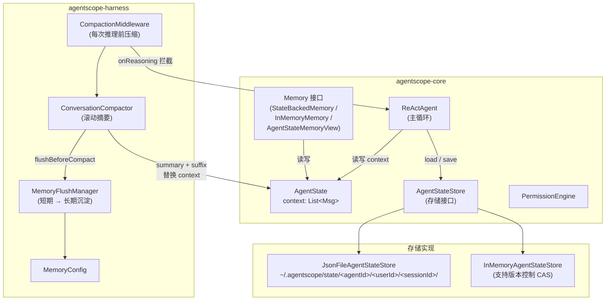
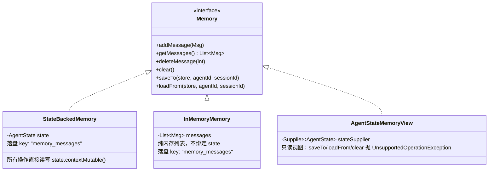
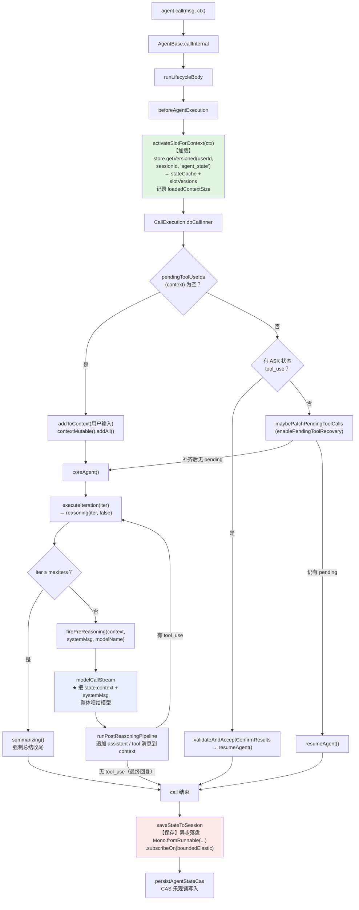
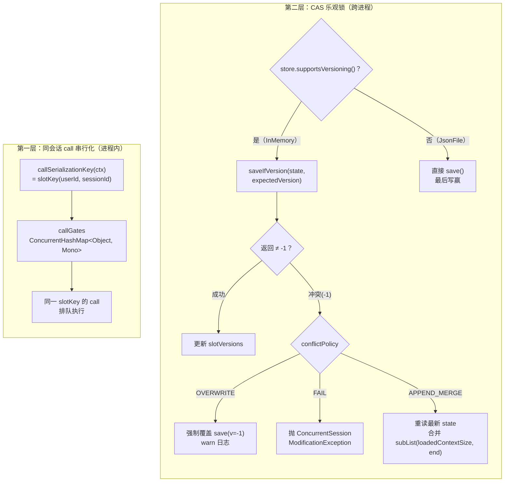
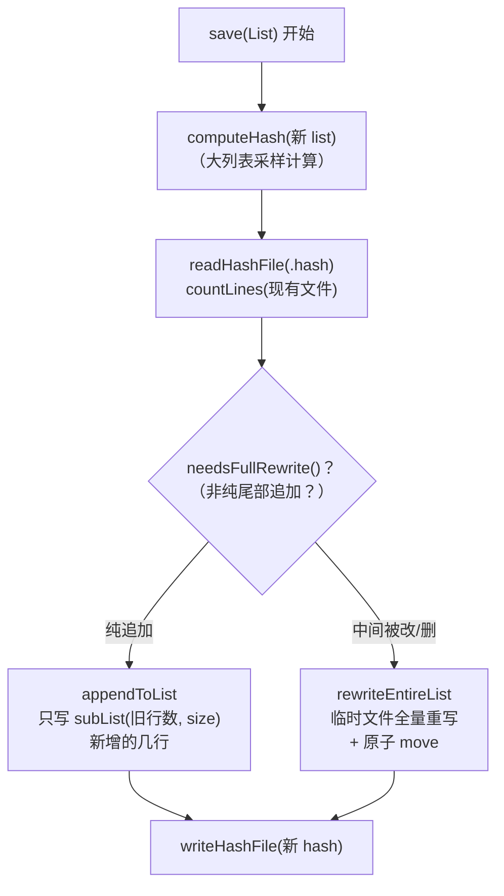
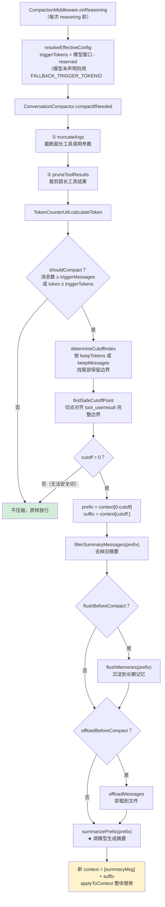
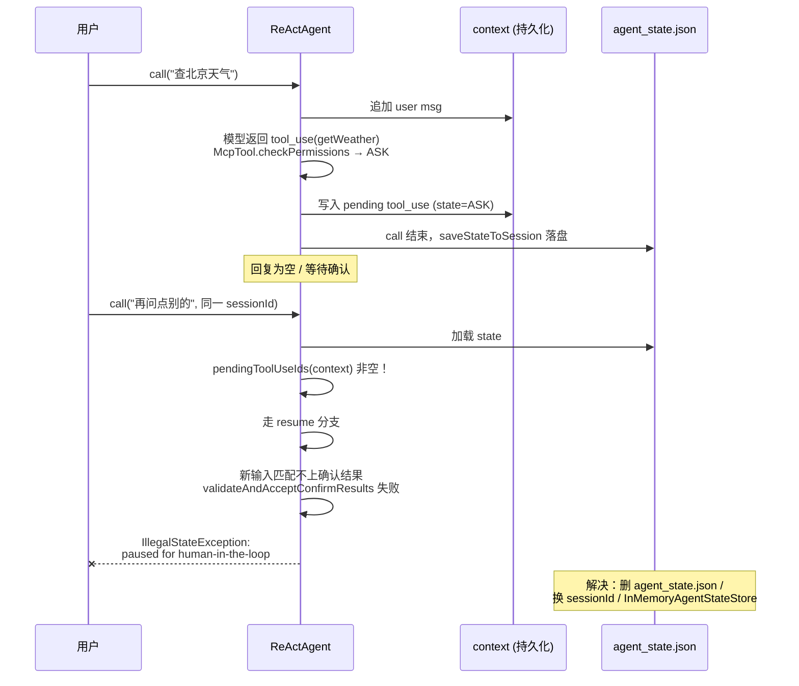

# AgentScope Java 2.x 短期记忆实现原理深入分析

> 基于 `agentscope-core-2.0.4` 与 `agentscope-harness-2.0.4` 反编译实证，并对照实际落盘的 `agent_state.json` 验证。

---

## 一、一句话定位

agentscope 的**短期记忆 = 当前会话的 `AgentState.context`，即一个按时间顺序排列的 `List<Msg>`**。它不是独立组件，而是嵌在会话状态里的对话历史；每轮推理整体喂给模型，call 结束时随 `AgentState` 一起持久化到状态仓库。

长期记忆（向量检索那套 `LongTermMemory`）是另一条线，短期记忆通过 `MemoryFlushManager` 向长期沉淀。

---

## 二、整体架构



<details>
<summary>📱 架构总览 SVG 图（点击展开）</summary>

<div align="center">

```svg
<svg width="860" height="620" viewBox="0 0 860 620" xmlns="http://www.w3.org/2000/svg" font-family="PingFang SC, Microsoft YaHei, sans-serif">
  <defs>
    <linearGradient id="coreBg" x1="0" y1="0" x2="0" y2="1">
      <stop offset="0" stop-color="#eef4ff"/>
      <stop offset="1" stop-color="#dbe8fc"/>
    </linearGradient>
    <linearGradient id="harnessBg" x1="0" y1="0" x2="0" y2="1">
      <stop offset="0" stop-color="#fff7e6"/>
      <stop offset="1" stop-color="#fdeecb"/>
    </linearGradient>
    <linearGradient id="storeBg" x1="0" y1="0" x2="0" y2="1">
      <stop offset="0" stop-color="#eefaf0"/>
      <stop offset="1" stop-color="#d8f2de"/>
    </linearGradient>
    <marker id="arrow" viewBox="0 0 10 10" refX="9" refY="5" markerWidth="7" markerHeight="7" orient="auto-start-reverse">
      <path d="M 0 0 L 10 5 L 0 10 z" fill="#5a6b8c"/>
    </marker>
  </defs>

  <!-- 标题 -->
  <text x="430" y="30" text-anchor="middle" font-size="18" font-weight="bold" fill="#2c3e50">AgentScope 短期记忆架构</text>

  <!-- Harness 层 -->
  <rect x="30" y="50" width="800" height="150" rx="12" fill="url(#harnessBg)" stroke="#e8b84b" stroke-width="1.5"/>
  <text x="50" y="75" font-size="13" font-weight="bold" fill="#9a6d00">agentscope-harness</text>

  <rect x="60" y="90" width="220" height="60" rx="8" fill="#fff" stroke="#e8b84b"/>
  <text x="170" y="114" text-anchor="middle" font-size="12" font-weight="bold" fill="#7a5a00">CompactionMiddleware</text>
  <text x="170" y="132" text-anchor="middle" font-size="10" fill="#9a7a2a">每次推理前触发压缩检查</text>

  <rect x="320" y="90" width="220" height="60" rx="8" fill="#fff" stroke="#e8b84b"/>
  <text x="430" y="114" text-anchor="middle" font-size="12" font-weight="bold" fill="#7a5a00">ConversationCompactor</text>
  <text x="430" y="132" text-anchor="middle" font-size="10" fill="#9a7a2a">滚动摘要：prefix 摘要 + suffix 保留</text>

  <rect x="580" y="90" width="220" height="60" rx="8" fill="#fff" stroke="#e8b84b"/>
  <text x="690" y="114" text-anchor="middle" font-size="12" font-weight="bold" fill="#7a5a00">MemoryFlushManager</text>
  <text x="690" y="132" text-anchor="middle" font-size="10" fill="#9a7a2a">短期记忆 → 长期记忆沉淀</text>

  <!-- Core 层 -->
  <rect x="30" y="230" width="800" height="200" rx="12" fill="url(#coreBg)" stroke="#5b8def" stroke-width="1.5"/>
  <text x="50" y="255" font-size="13" font-weight="bold" fill="#2b5cb8">agentscope-core</text>

  <rect x="60" y="270" width="180" height="70" rx="8" fill="#fff" stroke="#5b8def"/>
  <text x="150" y="294" text-anchor="middle" font-size="12" font-weight="bold" fill="#1e4fa0">ReActAgent</text>
  <text x="150" y="310" text-anchor="middle" font-size="10" fill="#4a6fa5">stateCache / slotVersions</text>
  <text x="150" y="324" text-anchor="middle" font-size="10" fill="#4a6fa5">persistAgentStateCas</text>

  <rect x="280" y="270" width="200" height="70" rx="8" fill="#fff" stroke="#5b8def" stroke-width="2"/>
  <text x="380" y="290" text-anchor="middle" font-size="12" font-weight="bold" fill="#1e4fa0">AgentState ★ 短期记忆载体</text>
  <text x="380" y="308" text-anchor="middle" font-size="10" fill="#c0392b">context: List&lt;Msg&gt;</text>
  <text x="380" y="322" text-anchor="middle" font-size="10" fill="#4a6fa5">getContext() 只读拷贝</text>
  <text x="380" y="336" text-anchor="middle" font-size="10" fill="#4a6fa5">contextMutable() 原地改</text>

  <rect x="520" y="270" width="140" height="70" rx="8" fill="#fff" stroke="#5b8def"/>
  <text x="590" y="294" text-anchor="middle" font-size="12" font-weight="bold" fill="#1e4fa0">Memory 接口</text>
  <text x="590" y="310" text-anchor="middle" font-size="10" fill="#4a6fa5">StateBackedMemory</text>
  <text x="590" y="324" text-anchor="middle" font-size="10" fill="#4a6fa5">InMemoryMemory</text>

  <rect x="60" y="365" width="250" height="50" rx="8" fill="#fff" stroke="#5b8def"/>
  <text x="185" y="385" text-anchor="middle" font-size="12" font-weight="bold" fill="#1e4fa0">CallExecution (内部类)</text>
  <text x="185" y="402" text-anchor="middle" font-size="10" fill="#4a6fa5">doCallInner / addToContext / executeIteration</text>

  <rect x="340" y="365" width="140" height="50" rx="8" fill="#fff" stroke="#5b8def"/>
  <text x="410" y="385" text-anchor="middle" font-size="12" font-weight="bold" fill="#1e4fa0">AgentStateStore</text>
  <text x="410" y="402" text-anchor="middle" font-size="10" fill="#4a6fa5">get / save / saveIfVersion</text>

  <rect x="510" y="365" width="150" height="50" rx="8" fill="#fff" stroke="#5b8def"/>
  <text x="585" y="385" text-anchor="middle" font-size="12" font-weight="bold" fill="#1e4fa0">GracefulShutdownManager</text>
  <text x="585" y="402" text-anchor="middle" font-size="10" fill="#4a6fa5">中断恢复</text>

  <!-- 存储层 -->
  <rect x="30" y="460" width="800" height="140" rx="12" fill="url(#storeBg)" stroke="#4caf7d" stroke-width="1.5"/>
  <text x="50" y="485" font-size="13" font-weight="bold" fill="#1e7a45">存储实现</text>

  <rect x="60" y="500" width="350" height="80" rx="8" fill="#fff" stroke="#4caf7d"/>
  <text x="235" y="522" text-anchor="middle" font-size="12" font-weight="bold" fill="#1e7a45">JsonFileAgentStateStore（默认）</text>
  <text x="235" y="540" text-anchor="middle" font-size="10" fill="#4a8a65">~/.agentscope/state/&lt;agentId&gt;/&lt;userId&gt;/&lt;sessionId&gt;/</text>
  <text x="235" y="556" text-anchor="middle" font-size="10" fill="#4a8a65">agent_state.json（单 JSON）+ .hash（增量判断）</text>
  <text x="235" y="572" text-anchor="middle" font-size="10" fill="#c0392b">不支持版本控制 → 最后写赢</text>

  <rect x="450" y="500" width="350" height="80" rx="8" fill="#fff" stroke="#4caf7d"/>
  <text x="625" y="522" text-anchor="middle" font-size="12" font-weight="bold" fill="#1e7a45">InMemoryAgentStateStore</text>
  <text x="625" y="540" text-anchor="middle" font-size="10" fill="#4a8a65">Map&lt;userId, Map&lt;sessionId, SessionData&gt;&gt;</text>
  <text x="625" y="556" text-anchor="middle" font-size="10" fill="#4a8a65">VersionedEntry 版本号</text>
  <text x="625" y="572" text-anchor="middle" font-size="10" fill="#1e7a45">支持 saveIfVersion CAS ✓</text>

  <!-- 连接线 -->
  <path d="M 280 305 L 275 305" stroke="#5a6b8c" stroke-width="1.5" marker-end="url(#arrow)" fill="none"/>
  <path d="M 250 335 L 275 320" stroke="#5a6b8c" stroke-width="1.5" marker-end="url(#arrow)" fill="none"/>
  <path d="M 150 340 L 150 365" stroke="#5a6b8c" stroke-width="1.5" marker-end="url(#arrow)" fill="none"/>
  <path d="M 480 385 L 500 385" stroke="#5a6b8c" stroke-width="1.5" marker-end="url(#arrow)" fill="none" transform="translate(0,20)"/>
  <path d="M 380 365 L 380 345" stroke="#5a6b8c" stroke-width="1.5" marker-end="url(#arrow)" fill="none"/>
  <path d="M 340 500 L 310 430" stroke="#5a6b8c" stroke-width="1.5" marker-end="url(#arrow)" fill="none"/>
  <path d="M 625 500 L 470 430" stroke="#5a6b8c" stroke-width="1.5" marker-end="url(#arrow)" fill="none"/>
  <path d="M 170 150 L 170 230" stroke="#e8a23b" stroke-width="2" marker-end="url(#arrow)" fill="none"/>
  <text x="185" y="195" font-size="10" fill="#b07800">onReasoning 拦截</text>
  <path d="M 430 150 L 400 210" stroke="#e8a23b" stroke-width="2" marker-end="url(#arrow)" fill="none"/>
  <text x="440" y="195" font-size="10" fill="#b07800">摘要替换 context</text>
  <path d="M 690 150 L 690 230" stroke="#e8a23b" stroke-width="2" marker-end="url(#arrow)" fill="none" stroke-dasharray="5,4"/>
  <text x="705" y="195" font-size="10" fill="#b07800">flush 时机</text>
</svg>
```

</div>

</details>

---

## 三、核心数据模型：`AgentState`

短期记忆的物理载体是 `AgentState` 里的一个字段：

```java
public final class AgentState {
  private final String sessionId;
  private final String userId;
  private String summary;              // 压缩产生的摘要
  private final List<Msg> context;     // ← 短期记忆就在这里
  private String replyId;
  private int curIter;
  private boolean shutdownInterrupted;
  private PermissionContextState permissionContext;
  private final ToolContextState toolContext;
  private final TaskContextState tasksContext;
  private final PlanModeContextState planModeContext;
}
```

对外暴露两个访问器（反编译确认）：

| 方法 | 行为 | 用途 |
|------|------|------|
| `getContext()` | `Collections.unmodifiableList(new ArrayList<>(context))` 防御性拷贝 | 外部只读访问 |
| `contextMutable()` | 直接返回原始 `context` 引用 | 内部循环原地增删 |

实际落盘文件 `~/.agentscope/state/mcp-demo-agent/wenbin/mcp-demo-session/agent_state.json` 印证了结构：整个 `AgentState` 序列化成**单个 JSON 对象**，`context` 是其中的数组，按顺序存着 USER → ASSISTANT(thinking+tool_use) → TOOL(tool_result) → ASSISTANT(text) 等所有消息。

```json
{
  "session_id" : "mcp-demo-session",
  "user_id" : "wenbin",
  "summary" : "",
  "context" : [ {
    "id" : "f834f2b0-...",
    "content" : [ { "type" : "text", "text" : "帮我查一下北京今天的天气..." } ],
    "role" : "USER"
  }, {
    "content" : [ { "type" : "thinking", ... }, { "type" : "tool_use", "name" : "getWeather", ... } ],
    "role" : "ASSISTANT"
  }, {
    "content" : [ { "type" : "tool_result", "output" : [...], "state" : "success" } ],
    "role" : "TOOL"
  } ]
}
```

---

## 四、`Memory` 接口与三种实现



**关键点**：`ReActAgent` 主循环**并不走 `Memory` 接口**。它直接持有 `AgentState`，通过内部类 `CallExecution.addToContext()` → `state.contextMutable().addAll(msgs)` 原地追加。

`Memory` 接口主要服务于 harness 中间件、子智能体、`SessionSearchTool` 这类需要统一访问记忆的组件，并且它们用的是独立的 `"memory_messages"` key（List/JSONL 格式），与主循环的 `"agent_state"` 单 key 是**两套存储**。

---

## 五、加载 / 保存调用链



### 反编译确认的关键事实

1. **加载时机**：每次 call 开始 `activateSlotForContext` → `loadOrCreateAgentStateForSlot` → `store.getVersioned(...)`。若没有，先试 `LegacyStateLoader`（兼容旧格式），再没有就 `freshState(...)` 新建。

2. **保存时机**：**每轮 ReAct 迭代不落盘，只在整个 call 结束时落盘一次**。`CallExecution` 里没有任何 `persistAgentStateCas` 调用。保存统一由 `doCall` 收尾触发：成功（flatMap）、失败（onErrorResume，非中断）、结果为空（switchIfEmpty）三种情况都会 `saveStateToSession`。

   > 这意味着：call 中途崩溃，当前 call 新增的消息会丢；但之前已完成的 call 都在盘上。

3. **异步刷盘**：`saveStateToSession` 用 `Schedulers.boundedElastic()`，不阻塞回复返回。

4. **`loadedContextSize`**：加载时记下 context 原始长度，CAS 冲突 APPEND_MERGE 时用来区分"历史消息"和"本次 call 新增的消息"。

---

## 六、并发控制：slot 串行化 + CAS 乐观锁



- **单机 + JsonFile 默认存储**：主要靠第一层串行化保证正确性。
- **多实例部署**：需要配支持版本化的 store + 合适的 `conflictPolicy`。
- `ConflictPolicy` 枚举：`OVERWRITE` / `FAIL` / `APPEND_MERGE`。

---

## 七、存储层细节

### JsonFileAgentStateStore（默认）

| 项 | 说明 |
|----|------|
| 根目录 | `${user.home}/.agentscope/state`（无参构造硬编码） |
| 会话路径 | `~/.agentscope/state/<agentId>/<userId>/<sessionId>/` |
| 单状态 | `agent_state.json`（整个 AgentState 一个 JSON） |
| List 状态 | JSONL 格式（每行一条 Msg 的 JSON），旁边伴 `.hash` 文件 |
| 版本控制 | ❌ 不支持（`supportsVersioning()` 默认 false） |

**增量写入优化**（`save(List)` 核心）：



> 重写用**临时文件 + 原子 move**（`CREATE/TRUNCATE_EXISTING/WRITE`），保证崩溃不损坏。大列表 hash 采样（`getSampleIndices` + `SAMPLING_THRESHOLD`）避免全量扫描。

### InMemoryAgentStateStore

- `Map<userId, Map<sessionId, SessionData>>` 纯内存
- **支持版本控制**：`VersionedEntry` 维护版本号，CAS 靠它
- 用于测试或刻意不持久化

---

## 八、上下文压缩：滚动摘要（harness 层）

core 的 `ReActAgent` 本身**不做截断**——context 无限增长。压缩是 harness 通过 `CompactionMiddleware` 加的，**每次模型推理前**触发。



### 压缩效果示意（SVG）

<div align="center">

```svg
<svg width="820" height="330" viewBox="0 0 820 330" xmlns="http://www.w3.org/2000/svg" font-family="PingFang SC, Microsoft YaHei, sans-serif">
  <defs>
    <marker id="arr2" viewBox="0 0 10 10" refX="9" refY="5" markerWidth="7" markerHeight="7" orient="auto-start-reverse">
      <path d="M 0 0 L 10 5 L 0 10 z" fill="#555"/>
    </marker>
  </defs>

  <text x="410" y="28" text-anchor="middle" font-size="15" font-weight="bold" fill="#2c3e50">滚动压缩：滑动窗口 + 滚动摘要</text>

  <!-- 压缩前 -->
  <text x="70" y="70" font-size="12" font-weight="bold" fill="#555">压缩前（context 无限增长）</text>
  <rect x="70" y="80" width="120" height="46" fill="#fde2e2" stroke="#e07b7b" rx="4"/>
  <text x="130" y="107" text-anchor="middle" font-size="11" fill="#a94442">早期旧消息</text>
  <rect x="190" y="80" width="120" height="46" fill="#fde2e2" stroke="#e07b7b" rx="4"/>
  <text x="250" y="100" text-anchor="middle" font-size="11" fill="#a94442">tool_use/result</text>
  <text x="250" y="116" text-anchor="middle" font-size="10" fill="#a94442">（可能超长）</text>
  <rect x="310" y="80" width="120" height="46" fill="#fde2e2" stroke="#e07b7b" rx="4"/>
  <text x="370" y="100" text-anchor="middle" font-size="11" fill="#a94442">中期对话</text>
  <text x="370" y="116" text-anchor="middle" font-size="10" fill="#a94442">（含旧摘要）</text>
  <rect x="430" y="80" width="150" height="46" fill="#d4edda" stroke="#7bbf8f" rx="4" stroke-width="2"/>
  <text x="505" y="100" text-anchor="middle" font-size="11" fill="#1e7a45">最近 keepTokens</text>
  <text x="505" y="116" text-anchor="middle" font-size="10" fill="#1e7a45">原文保留窗口</text>
  <text x="600" y="107" font-size="12" fill="#c0392b" font-weight="bold">← token ≥ triggerTokens</text>

  <!-- 箭头 -->
  <path d="M 290 140 L 290 175" stroke="#555" stroke-width="2" marker-end="url(#arr2)" fill="none"/>
  <text x="300" y="162" font-size="11" fill="#555">Compaction</text>

  <!-- 压缩后 -->
  <text x="70" y="205" font-size="12" font-weight="bold" fill="#555">压缩后</text>
  <rect x="70" y="215" width="180" height="46" fill="#fff3cd" stroke="#e8b84b" rx="4" stroke-width="2"/>
  <text x="160" y="235" text-anchor="middle" font-size="11" font-weight="bold" fill="#9a6d00">summaryMsg（摘要）</text>
  <text x="160" y="251" text-anchor="middle" font-size="10" fill="#9a6d00">name = SUMMARY_MSG_NAME</text>
  <path d="M 250 238 L 270 238" stroke="#555" stroke-width="2" marker-end="url(#arr2)" fill="none"/>
  <rect x="270" y="215" width="310" height="46" fill="#d4edda" stroke="#7bbf8f" rx="4" stroke-width="2"/>
  <text x="425" y="235" text-anchor="middle" font-size="11" fill="#1e7a45">suffix（最近对话，原文不动）</text>
  <text x="425" y="251" text-anchor="middle" font-size="10" fill="#1e7a45">切点保证 tool_use/result 成对完整</text>

  <!-- 说明 -->
  <rect x="70" y="280" width="680" height="40" rx="6" fill="#f0f4f8" stroke="#c8d2dc"/>
  <text x="410" y="298" text-anchor="middle" font-size="11" fill="#4a5a6a">可选：flushBeforeCompact → prefix 先沉淀到长期记忆（不丢失，只是降级为"冷记忆"）</text>
  <text x="410" y="313" text-anchor="middle" font-size="11" fill="#4a5a6a">阈值：triggerTokens = model.getContextWindowSize() - reserved（来自 ModelContextWindows 各模型映射表）</text>
</svg>
```

</div>

---

## 九、短期 → 长期的桥梁：`MemoryFlushManager`

`MemoryFlushManager` 把短期记忆内容沉淀到 workspace 文件（`<workspace>/memory/` 下的 daily / session 文件），由 `MemoryConfig` 驱动：

| 配置 | 说明 |
|------|------|
| `flushTrigger` | 何时冲刷 |
| `consolidationMaxTokens` / `consolidationMinGap` | 合并阈值与最小间隔 |
| `flushPrompt` / `consolidationPrompt` | 让模型生成记忆文本的提示词 |
| `sessionRetentionDays` / `dailyFileRetentionDays` | 保留清理 |

冲刷时过滤 `isInternalContextMessage` / `isCompactionSummaryMessage` / `isSessionContextMessage`，只把有价值的对话写出去。

压缩时若开了 `flushBeforeCompact`，被截掉的前缀会**先冲刷到长期记忆再总结**——早期信息不会因压缩而丢失，只是从短期"热记忆"降级为长期"冷记忆"。

---

## 十、与实际踩坑的呼应

### 1. "回复为空"
模型返回的 Msg 只有 `ThinkingBlock` + `ToolUseBlock`，没有 `TextBlock`；`Msg.getTextContent()` 只拼接 `TextBlock`，所以打印为空。消息其实已经正常进了 context（`agent_state.json` 里能看到那条 ASSISTANT 的 thinking+tool_use）。

### 2. "paused for human-in-the-loop confirmation"



本质是清掉那条持久化的 pending tool_use。

---

## 十一、总结

| 维度 | 结论 |
|------|------|
| 载体 | `AgentState.context: List<Msg>`，会话内按时间序的完整消息列表 |
| 读 | 每轮推理整体喂模型（无滑动窗口截断，靠压缩中间件控制） |
| 写 | `contextMutable()` 原地追加；`getContext()` 防御性拷贝 |
| 持久化 | call 结束时整体序列化到 `~/.agentscope/state/.../agent_state.json`（异步） |
| 并发 | 进程内 slotKey 串行化 + 跨进程 CAS（可选版本化 store） |
| 防膨胀 | harness `CompactionMiddleware`：truncateArgs → prune → 滚动摘要 |
| 长期化 | `MemoryFlushManager` 冲刷沉淀，压缩前缀不丢失 |
| 崩溃恢复 | pending tool_use / 中断状态都在 state 里，重启后 resume |
