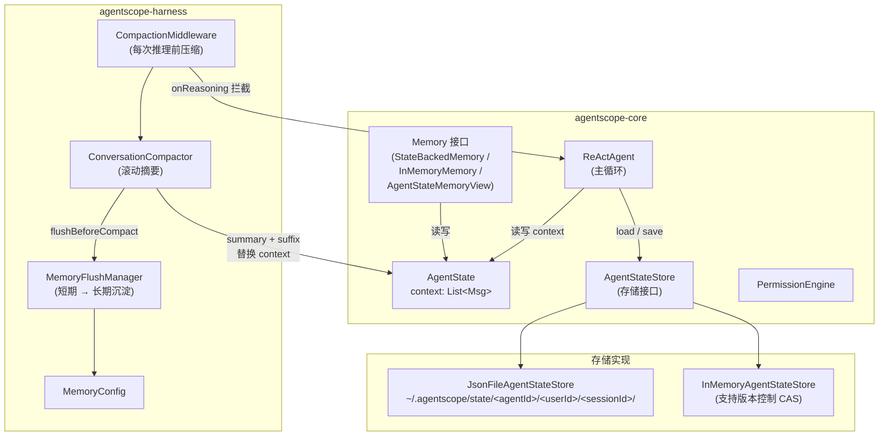
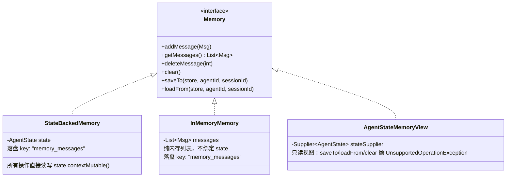
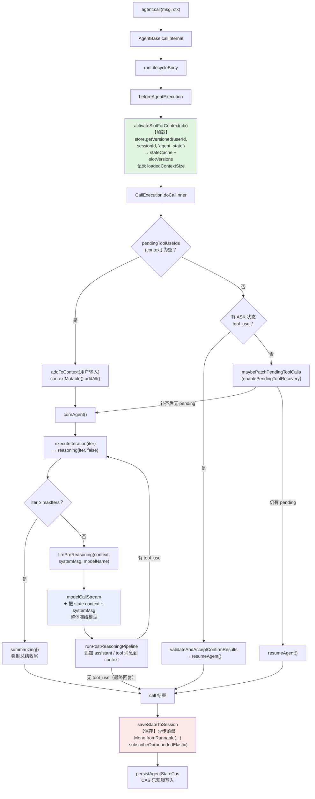
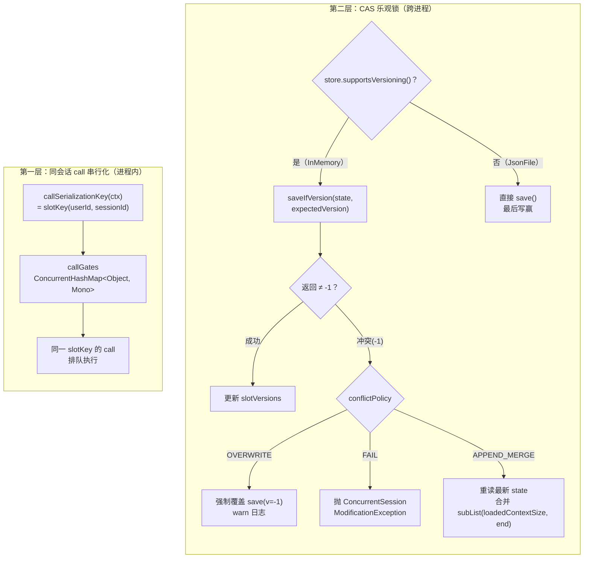
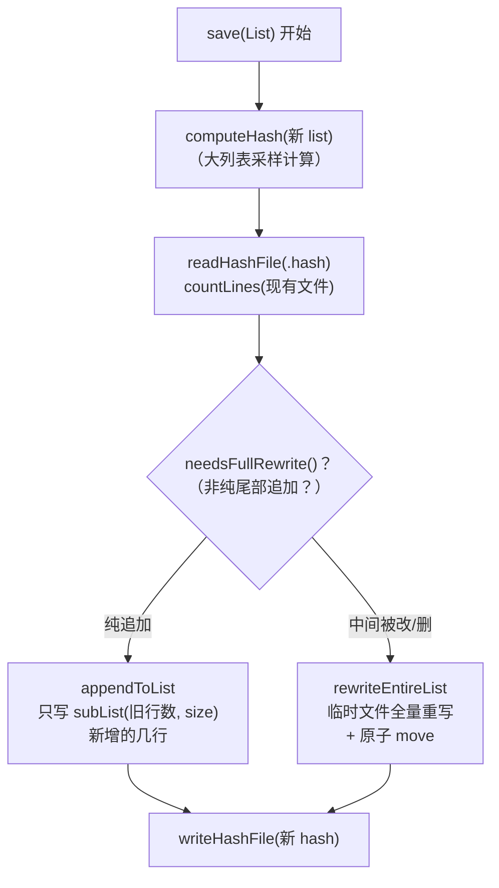
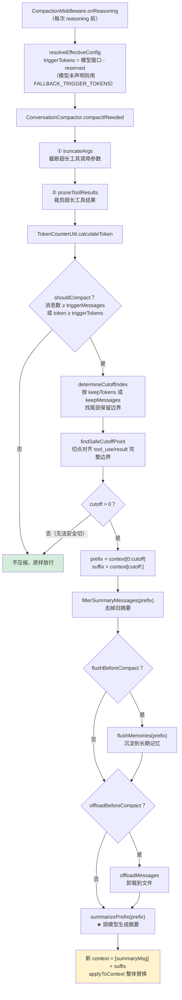
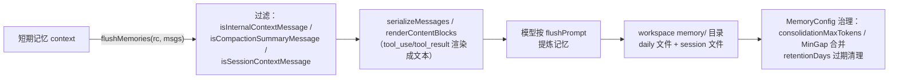
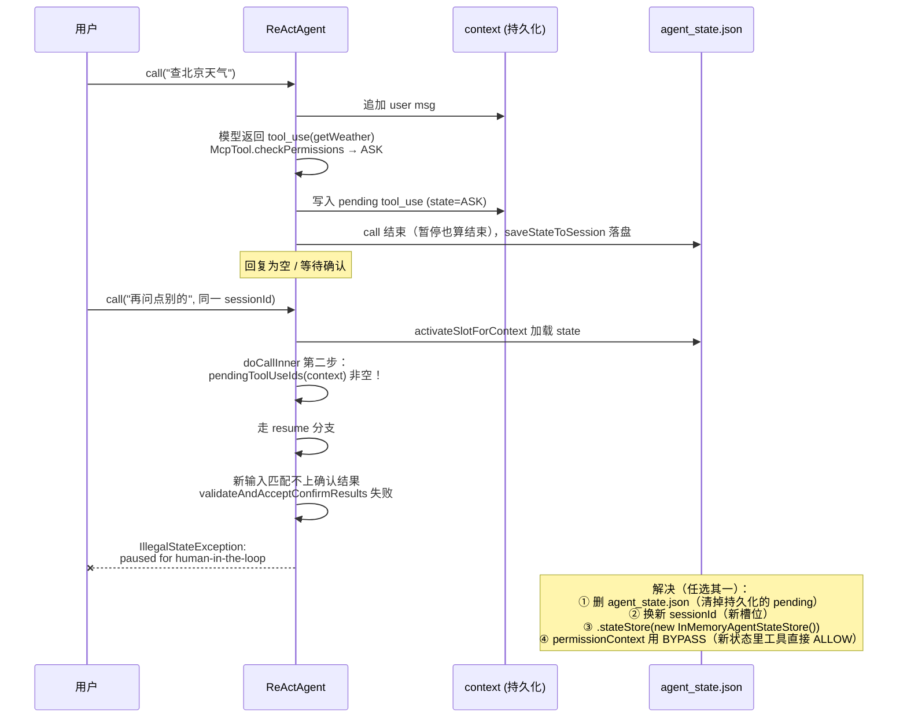

# AgentScope Java 2.x 短期记忆实现原理深入分析

> 分析对象：`agentscope-core-2.0.4` 与 `agentscope-harness-2.0.4`。
> 方法：反编译字节码（javap）逐方法核对控制流 + 对照本机实际落盘的 `~/.agentscope/state/` 文件验证。
> 本文不只回答"是什么"，重点回答"**为什么这样设计**"以及"**每个结论的字节码证据**"。

---

## 一、设计定位：短期记忆不是一个组件，而是一种视角

### 1.1 核心论断

在 AgentScope Java 2.x 中，**不存在一个独立的、叫"ShortTermMemory"的组件**。所谓短期记忆，本质上是：

> **`AgentState.context` —— 一个按时间顺序追加的 `List<Msg>`，跟随会话（sessionId）生命周期，随状态一起持久化。**

这是一个刻意的架构决策，理解它需要先看一个普遍的设计困境：

**困境**：Agent 在一次会话中需要记住的东西，远不止对话消息：
- 对话历史（用户说了什么、我回了什么、调了什么工具）
- 工具调用权限的当前状态（哪些工具被用户批准过）
- 任务列表、计划模式的中间状态
- ReAct 循环进行到第几轮（`curIter`）
- 被中断暂停时的恢复点（`replyId`、pending tool_use）

如果"对话记忆"单独做一个 Memory 组件，"权限状态"单独做一个组件，"任务状态"再做
一个……那么**持久化、恢复、并发控制、故障恢复都要做 N 遍**，而且这些状态之间有强
一致性要求（比如"一条 pending 的 tool_use 消息"和"对应的权限上下文"必须原子地一起
落盘，否则恢复后状态错乱）。

AgentScope 的解法是**单一状态源（Single Source of Truth）**：把所有会话级可变状态
打包进一个 `AgentState`，短期记忆（context）只是其中一个字段。这样一来：

1. **持久化只需序列化一个对象**——落盘的就是 `agent_state.json` 这一个文件；
2. **恢复就是整体反序列化**——重启/新进程接手时，一个 `get` 就恢复了全部上下文；
3. **并发控制只需要保护一个对象**——CAS 乐观锁锁的是整个 state，天然原子；
4. **人机协作暂停（ASK）才能可靠工作**——"暂停点"的消息和权限状态在同一个事务单元里。

这也解释了你之前遇到的 bug 的深层原因：**正是因为 context 和权限状态一起原子落盘，
一条"等待确认的 tool_use"才会在进程重启后原样复活**。这是同一枚硬币的两面——
可靠性机制的代价。

### 1.2 与长期记忆的分界

| | 短期记忆 | 长期记忆 |
|---|---|---|
| 物理载体 | `AgentState.context`（内存 List + JSON 文件） | workspace 下 `memory/` 目录文件 / 向量库 |
| 生命周期 | 会话（sessionId） | 跨会话（用户级） |
| 访问方式 | 每轮推理整体注入 prompt | 按需检索（`SessionSearchTool` 等） |
| 写入时机 | 每轮 ReAct 迭代追加 | `MemoryFlushManager` 冲刷沉淀 |
| 内容形态 | 逐字原文（后端压缩成摘要） | 提炼过的记忆文本 |

两者通过 `MemoryFlushManager` 单向流动：短期 → 长期。压缩发生时，被截断的旧对话
若配置了 `flushBeforeCompact`，会先沉淀到长期记忆再删除——**信息不丢失，只是从
"热记忆"降级为"冷记忆"**。

---

## 二、整体架构



**分层职责**（为什么 core 和 harness 各管一半）：

- **core（`ReActAgent`）**：负责记忆的"正确性"——追加、恢复、持久化、并发控制。core 层
  **故意不做截断**，`context` 无限增长。这是一个干净的职责切分：core 是一个通用的
  ReAct 执行引擎，不应该假设"上下文有窗口限制"（万一模型窗口无限大呢？）。
- **harness（`CompactionMiddleware`）**：负责记忆的"经济性"——在真实模型的有限窗口下
  控制成本。它以中间件的形式外挂，通过 `onReasoning` 钩子在每轮推理前介入。不想要
  压缩？不挂这个中间件即可，core 完全不受影响。

这种"引擎管语义、中间件管策略"的分层，和 Web 框架里"Servlet 管协议、Filter 管横切
关注点"是同一种思路。

<details>
<summary>📱 架构总览 SVG 图（点击展开）</summary>

<div align="center">

```svg
<svg width="860" height="620" viewBox="0 0 860 620" xmlns="http://www.w3.org/2000/svg" font-family="PingFang SC, Microsoft YaHei, sans-serif">
  <defs>
    <linearGradient id="coreBg" x1="0" y1="0" x2="0" y2="1">
      <stop offset="0" stop-color="#eef4ff"/>
      <stop offset="1" stop-color="#dbe8fc"/>
    </linearGradient>
    <linearGradient id="harnessBg" x1="0" y1="0" x2="0" y2="1">
      <stop offset="0" stop-color="#fff7e6"/>
      <stop offset="1" stop-color="#fdeecb"/>
    </linearGradient>
    <linearGradient id="storeBg" x1="0" y1="0" x2="0" y2="1">
      <stop offset="0" stop-color="#eefaf0"/>
      <stop offset="1" stop-color="#d8f2de"/>
    </linearGradient>
    <marker id="arrow" viewBox="0 0 10 10" refX="9" refY="5" markerWidth="7" markerHeight="7" orient="auto-start-reverse">
      <path d="M 0 0 L 10 5 L 0 10 z" fill="#5a6b8c"/>
    </marker>
  </defs>

  <text x="430" y="30" text-anchor="middle" font-size="18" font-weight="bold" fill="#2c3e50">AgentScope 短期记忆架构</text>

  <rect x="30" y="50" width="800" height="150" rx="12" fill="url(#harnessBg)" stroke="#e8b84b" stroke-width="1.5"/>
  <text x="50" y="75" font-size="13" font-weight="bold" fill="#9a6d00">agentscope-harness（策略层）</text>

  <rect x="60" y="90" width="220" height="60" rx="8" fill="#fff" stroke="#e8b84b"/>
  <text x="170" y="114" text-anchor="middle" font-size="12" font-weight="bold" fill="#7a5a00">CompactionMiddleware</text>
  <text x="170" y="132" text-anchor="middle" font-size="10" fill="#9a7a2a">每次推理前触发压缩检查</text>

  <rect x="320" y="90" width="220" height="60" rx="8" fill="#fff" stroke="#e8b84b"/>
  <text x="430" y="114" text-anchor="middle" font-size="12" font-weight="bold" fill="#7a5a00">ConversationCompactor</text>
  <text x="430" y="132" text-anchor="middle" font-size="10" fill="#9a7a2a">滚动摘要：prefix 摘要 + suffix 保留</text>

  <rect x="580" y="90" width="220" height="60" rx="8" fill="#fff" stroke="#e8b84b"/>
  <text x="690" y="114" text-anchor="middle" font-size="12" font-weight="bold" fill="#7a5a00">MemoryFlushManager</text>
  <text x="690" y="132" text-anchor="middle" font-size="10" fill="#9a7a2a">短期记忆 → 长期记忆沉淀</text>

  <rect x="30" y="230" width="800" height="200" rx="12" fill="url(#coreBg)" stroke="#5b8def" stroke-width="1.5"/>
  <text x="50" y="255" font-size="13" font-weight="bold" fill="#2b5cb8">agentscope-core（引擎层：语义正确性）</text>

  <rect x="60" y="270" width="180" height="70" rx="8" fill="#fff" stroke="#5b8def"/>
  <text x="150" y="294" text-anchor="middle" font-size="12" font-weight="bold" fill="#1e4fa0">ReActAgent</text>
  <text x="150" y="310" text-anchor="middle" font-size="10" fill="#4a6fa5">stateCache / slotVersions</text>
  <text x="150" y="324" text-anchor="middle" font-size="10" fill="#4a6fa5">persistAgentStateCas</text>

  <rect x="280" y="270" width="200" height="70" rx="8" fill="#fff" stroke="#5b8def" stroke-width="2"/>
  <text x="380" y="290" text-anchor="middle" font-size="12" font-weight="bold" fill="#1e4fa0">AgentState ★ 短期记忆载体</text>
  <text x="380" y="308" text-anchor="middle" font-size="10" fill="#c0392b">context: List&lt;Msg&gt;</text>
  <text x="380" y="322" text-anchor="middle" font-size="10" fill="#4a6fa5">getContext() 只读拷贝</text>
  <text x="380" y="336" text-anchor="middle" font-size="10" fill="#4a6fa5">contextMutable() 原地改</text>

  <rect x="520" y="270" width="140" height="70" rx="8" fill="#fff" stroke="#5b8def"/>
  <text x="590" y="294" text-anchor="middle" font-size="12" font-weight="bold" fill="#1e4fa0">Memory 接口</text>
  <text x="590" y="310" text-anchor="middle" font-size="10" fill="#4a6fa5">StateBackedMemory</text>
  <text x="590" y="324" text-anchor="middle" font-size="10" fill="#4a6fa5">InMemoryMemory</text>

  <rect x="60" y="365" width="250" height="50" rx="8" fill="#fff" stroke="#5b8def"/>
  <text x="185" y="385" text-anchor="middle" font-size="12" font-weight="bold" fill="#1e4fa0">CallExecution (内部类)</text>
  <text x="185" y="402" text-anchor="middle" font-size="10" fill="#4a6fa5">doCallInner / addToContext / executeIteration</text>

  <rect x="340" y="365" width="140" height="50" rx="8" fill="#fff" stroke="#5b8def"/>
  <text x="410" y="385" text-anchor="middle" font-size="12" font-weight="bold" fill="#1e4fa0">AgentStateStore</text>
  <text x="410" y="402" text-anchor="middle" font-size="10" fill="#4a6fa5">get / save / saveIfVersion</text>

  <rect x="510" y="365" width="150" height="50" rx="8" fill="#fff" stroke="#5b8def"/>
  <text x="585" y="385" text-anchor="middle" font-size="12" font-weight="bold" fill="#1e4fa0">GracefulShutdownManager</text>
  <text x="585" y="402" text-anchor="middle" font-size="10" fill="#4a6fa5">中断恢复</text>

  <rect x="30" y="460" width="800" height="140" rx="12" fill="url(#storeBg)" stroke="#4caf7d" stroke-width="1.5"/>
  <text x="50" y="485" font-size="13" font-weight="bold" fill="#1e7a45">存储实现</text>

  <rect x="60" y="500" width="350" height="80" rx="8" fill="#fff" stroke="#4caf7d"/>
  <text x="235" y="522" text-anchor="middle" font-size="12" font-weight="bold" fill="#1e7a45">JsonFileAgentStateStore（默认）</text>
  <text x="235" y="540" text-anchor="middle" font-size="10" fill="#4a8a65">~/.agentscope/state/&lt;agentId&gt;/&lt;userId&gt;/&lt;sessionId&gt;/</text>
  <text x="235" y="556" text-anchor="middle" font-size="10" fill="#4a8a65">agent_state.json（单 JSON）+ .hash（增量判断）</text>
  <text x="235" y="572" text-anchor="middle" font-size="10" fill="#c0392b">不支持版本控制 → 最后写赢</text>

  <rect x="450" y="500" width="350" height="80" rx="8" fill="#fff" stroke="#4caf7d"/>
  <text x="625" y="522" text-anchor="middle" font-size="12" font-weight="bold" fill="#1e7a45">InMemoryAgentStateStore</text>
  <text x="625" y="540" text-anchor="middle" font-size="10" fill="#4a8a65">Map&lt;userId, Map&lt;sessionId, SessionData&gt;&gt;</text>
  <text x="625" y="556" text-anchor="middle" font-size="10" fill="#4a8a65">VersionedEntry 版本号</text>
  <text x="625" y="572" text-anchor="middle" font-size="10" fill="#1e7a45">支持 saveIfVersion CAS ✓</text>

  <path d="M 250 335 L 275 320" stroke="#5a6b8c" stroke-width="1.5" marker-end="url(#arrow)" fill="none"/>
  <path d="M 150 340 L 150 365" stroke="#5a6b8c" stroke-width="1.5" marker-end="url(#arrow)" fill="none"/>
  <path d="M 340 500 L 310 430" stroke="#5a6b8c" stroke-width="1.5" marker-end="url(#arrow)" fill="none"/>
  <path d="M 625 500 L 470 430" stroke="#5a6b8c" stroke-width="1.5" marker-end="url(#arrow)" fill="none"/>
  <path d="M 170 150 L 170 230" stroke="#e8a23b" stroke-width="2" marker-end="url(#arrow)" fill="none"/>
  <text x="185" y="195" font-size="10" fill="#b07800">onReasoning 拦截</text>
  <path d="M 430 150 L 400 210" stroke="#e8a23b" stroke-width="2" marker-end="url(#arrow)" fill="none"/>
  <text x="440" y="195" font-size="10" fill="#b07800">摘要替换 context</text>
  <path d="M 690 150 L 690 230" stroke="#e8a23b" stroke-width="2" marker-end="url(#arrow)" fill="none" stroke-dasharray="5,4"/>
  <text x="705" y="195" font-size="10" fill="#b07800">flush 时机</text>
</svg>
```

</div>

</details>

---

## 三、核心数据模型：`AgentState` 逐字段解析

```java
public final class AgentState {
  private final String sessionId;                    // 会话标识（不可变，状态的身份）
  private final String userId;                       // 用户标识（多租户隔离键）
  private String summary;                           // 会话级摘要（区别于压缩摘要消息）
  private final List<Msg> context;                  // ★ 短期记忆
  private String replyId;                           // 当前"回复轮次"的 hex 标识
  private int curIter;                              // ReAct 当前迭代轮数
  private boolean shutdownInterrupted;              // 优雅停机时是否被中断
  private PermissionContextState permissionContext;// 工具权限模式与已批准规则
  private final ToolContextState toolContext;       // 工具运行时状态
  private final TaskContextState tasksContext;      // 任务列表状态
  private final PlanModeContextState planModeContext; // 计划模式状态
}
```

### 3.1 为什么 context 是"裸 List"而不是封装类

反编译显示 `context` 就是 `java.util.ArrayList<Msg>`，没有用任何树/索引/分片结构。理由：

1. **消费方式决定了结构**。模型 API（OpenAI 风格）接收的是**有序消息数组**，
   AgentScope 每轮推理就是 `context` 整体（加上 systemMsg）转成请求体。数组是最贴合
   消费形态的结构，无需转换。
2. **追加是唯一的高频写操作**。每轮 ReAct 迭代只做 `add`（以及压缩时罕见的整体替换），
   ArrayList 的尾部追加是 O(1)。
3. **序列化简单**。`toJson()` 直接 `JsonCodec.toPrettyJson(state)`，Jackson 对 ArrayList
   的处理是零成本路径。

### 3.2 双访问器：一个字段的"两种人格"

这是本实现里最值得玩味的设计。同一个 `context` 字段有两个公开入口，行为截然不同：

```java
// 防御性拷贝：new ArrayList<>(context) 再包 unmodifiableList
public List<Msg> getContext() { ... }

// 直接返回内部原始引用
public List<Msg> contextMutable() { ... }
```

**为什么需要 `getContext()` 的防御性拷贝？** 因为 `AgentState` 是被共享的：中间件、
hooks、子智能体、用户的回调都会拿到 state 并可能读 context。如果直接给内部引用，
任何一个调用方的意外修改（甚至遍历时 remove）都会污染主循环。拷贝 + 只读包装把
"读"这个动作变成了绝对安全。

**为什么还需要 `contextMutable()` 这个"逃生门"？** 因为对主循环自己来说，拷贝是纯
浪费：`CallExecution.addToContext()` 每轮都要追加消息，如果每次都拷贝整个历史再替换，
O(n) 复杂度会随对话变长线性恶化。主循环是框架内部代码，天然可信，给它原始引用
换取 O(1) 追加。

这是一种**按信任级别分层暴露可变性**的手法：外部一律只读，内部高权限直改。代价是
`contextMutable()` 属于 public 方法，理论上外部也能调——框架靠文档约定（方法名
Mutable 自带警告语义）而不是语言机制来约束。

### 3.3 Msg 在 context 里的存储形态

从实际落盘的 `agent_state.json` 可验证，每条 Msg 完整保留：

```json
{
  "id" : "f834f2b0-961e-4559-a656-c9a16af21477",   // UUID，恢复时配对 tool_use/result 用
  "name" : null,                                    // 发送者名（assistant 名 / 工具名）
  "content" : [ /* ContentBlock 数组 */ ],
  "metadata" : { "_chat_usage" : { "inputTokens" : 5898, ... } },
  "timestamp" : "2026-11-23 22:57:09.805",
  "usage" : { ... },                                 // token 用量（聚合统计用）
  "role" : "USER"                                    // USER / ASSISTANT / TOOL
}
```

`content` 是多形态块数组（`text` / `thinking` / `tool_use` / `tool_result`），
一条 ASSISTANT 消息可以同时含 thinking 块和多个 tool_use 块——这直接解释了
"回复为空"问题：`Msg.getTextContent()` 只拼接 `TextBlock`，纯 thinking+tool_use
的中间消息打出来就是空串，但它在 context 里是完整存在的（这是特性不是 bug：
中间轮次本来就不该有文本）。

两个对故障恢复至关重要的细节：
- **`tool_use` 块带 `state` 字段**（如 `"state" : "allowed"`），持久化了权限裁决结果；
- **`tool_use` 和 `tool_result` 通过 `id` 配对**，恢复逻辑（`maybePatchPendingToolCalls`、
  `validateAndAddToolResults`）全靠这个 id 匹配。

### 3.4 序列化实现

```java
public String toJson()          { return JsonUtils.getJsonCodec().toPrettyJson(this); }
public static AgentState fromJsonString(String s) {
  return JsonUtils.getJsonCodec().fromJson(s, AgentState.class);
}
```

没有手写 DTO、没有 Map 中转，直接 Jackson 序列化整个对象。`fromJson` 是一个
包私有静态工厂，带 11 个参数（sessionId/userId/summary/context/replyId/curIter/
shutdownInterrupted/permission/tool/tasks/planMode），对应 Builder 的完整字段——
这是 Jackson 反序列化走 `@JsonCreator` 风格的入口。整个状态一个 JSON 文件，
没有引用、没有分片，**落盘单元 = 内存单元**，这是"单一状态源"决策在存储上的延续。

---

## 四、`Memory` 接口：一套给"外部访问者"的统一门面

### 4.1 接口与三个实现



反编译 `StateBackedMemory` 的完整方法体后可以精确描述它做了什么：

- `addMessage(m)` → `state.contextMutable().add(m)` —— 一行委托；
- `getMessages()` → `new ArrayList<>(state.contextMutable())` —— 同样防御性拷贝；
- `saveTo(store, agentId, sessionId)` → 把 context **拷贝成新 List** 后调
  `store.save(agentId, sessionId, "memory_messages", list)` —— 注意这里用的是
  **save(List) 的 JSONL 存储路径**，而主循环用的是 save(State) 的单 JSON 路径；
- `loadFrom(...)` → `store.getList(..., "memory_messages", Msg.class)`，然后
  `clear() + addAll(...)` 原地重建。

### 4.2 一个容易踩的坑：`Memory` 接口和主循环是两套存储

这是反编译比对后才能发现的关键事实：

| 使用方 | 存储 key | 文件形态 | 时机 |
|--------|----------|----------|------|
| `ReActAgent` 主循环 | `"agent_state"` | `agent_state.json`（单 JSON） | call 结束 |
| `Memory` 接口实现 | `"memory_messages"` | JSONL（每行一条） | 显式调 saveTo 时 |

**`ReActAgent` 主循环完全不走 `Memory` 接口**。字节码证据：整个 `ReActAgent`
和其内部类 `CallExecution` 中没有任何对 `Memory` / `StateBackedMemory` 的引用
（grep 常量池只命中 `CallExecution` 直接操作 `contextMutable()`）。`Memory`
接口的消费方是 harness 中间件、子智能体（`SubagentsMiddleware`）、
`SessionSearchTool`、`LegacyStateLoader` 等外围组件——它们需要一个统一的
"对话历史读写门面"，但**不应该**拿到直接改主循环 context 的权力。

`AgentStateMemoryView` 的只读设计更进一步：`saveTo/loadFrom/clear` 全部抛
`UnsupportedOperationException`（`readOnly()` 私有工厂统一生成异常），连
`addMessage`/`deleteMessage` 也只是转发到 supplier 拿到的 state。它存在的意义
是：**给回调/插件一个类型安全的"你只能看"的合同**，用运行时异常代替文档约束。

### 4.3 设计评价

这套门面的好处是解耦：外围组件只依赖 6 个方法的窄接口，主循环的实现细节
（AgentState、CAS、缓存）全部藏在后面。代价是概念上容易混淆——同一个
"会话记忆"在框架里有两个视图、两条持久化路径。学习者的常见误解就是以为改
`Memory` 实现能影响主循环，实际上**主循环的记忆行为只由 `AgentState` +
`AgentStateStore` 决定**。

---

## 五、加载/保存调用链：一次 `call` 的完整记忆之旅



下面逐步展开每一步的原理与字节码证据。

### 5.1 加载：`activateSlotForContext` —— 三级回退的"槽位"激活

call 一进来（`beforeAgentExecution`），第一件事是确定"这次 call 操作的是哪个会话
槽位"：

```java
// 字节码还原的逻辑
String sessionId = isBlank(ctx.getSessionId()) ? defaultSessionId : ctx.getSessionId();
String userId    = ctx.getUserId();                    // 可为 null → "__anon__"
String slotKey   = slotKey(userId, sessionId);          // "userId|sessionId" 拼接
```

然后分两条路：

**有 stateStore 时（持久化模式）**——`loadOrCreateAgentStateForSlot(store, userId,
sessionId, initialPermissionContext, agentId, initialActiveToolGroups)`，内部是
**三级回退**：

1. `store.getVersioned(userId, sessionId, "agent_state", AgentState.class)` ——
   正常路径：读现有状态 + 它的版本号（供后续 CAS 用）；
2. 读不到 → `LegacyStateLoader.loadFromLegacySessionWithPresence(store, ...)` ——
   **兼容旧版格式**（旧版把记忆存在 `"memory_messages"` 这个 List key 下）。
   这说明 2.x 经历过一次存储格式迁移，新代码保留了自动迁移逻辑，读到旧格式
   就整体转换成新 `AgentState`，版本号按 store 是否支持版本化给 0 或 -1；
3. 仍读不到 → `freshState(...)` —— 全新会话，`AgentState.builder()` 空 context，
   把 builder 传入的**初始权限上下文**（你在 McpDemo 里配的 `BYPASS` 模式就
   从这里进入状态）和初始工具组写进新状态。

加载成功后，把 state 放进 `stateCache`（slotKey → AgentState），版本号放进
`slotVersions`（slotKey → Long），最后打包成 `CallExecution`（含 state、
`loadedVersion`、`loadedContextSize`、permissionEngine）放进 Reactor Context
贯穿整个 call。

**无 stateStore 时**——`stateCache.computeIfAbsent(slotKey, ...)` 纯内存懒创建，
连版本号都没有。

`loadedContextSize` 这个字段值得单独说：它记的是**本次 call 开始时 context 的
长度**。它的唯一用途在 CAS 冲突的 `APPEND_MERGE` 策略里——冲突时，框架重新读
了磁盘上的最新状态，但**不能直接整体覆盖内存状态**（会丢掉本 call 已追加的
消息），也不能整体追加（会重复历史）。正确做法是只把
`subList(loadedContextSize, currentSize)`——即"本次 call 新增的部分"——合并
到最新状态上。`loadedContextSize` 就是这条分界线。

### 5.2 入口决策：`doCallInner` 的 pending 恢复状态机

`doCallInner(List<Msg>)` 是整个记忆读写最精妙的部分，它本质上是一个**基于
context 内容的状态机**：

```
第一步：checkAndClearShutdownInterruptedForState —— 优雅停机中断的会话，
        丢弃重复输入（防止停机恢复后旧输入重放）
第二步：pendingToolUseIds = MessageUtils.pendingToolUseIds(context)
        —— 扫描 context，找所有"有 tool_use 但没有对应 tool_result"的 id
第三步：分支决策（见上图）
```

四个分支的语义：

- **无 pending** → 正常路：新输入 `addToContext` 后从 `coreAgent()`（第 0 轮推理）开始。
- **有 pending 且是 ASK 状态** → 用户这次 call 带来的输入被解释为**确认结果**
  （`validateAndAcceptConfirmResults`），走 `resumeAgent()` 从中断点继续。
- **有 pending 且开了 `enablePendingToolRecovery`** → `maybePatchPendingToolCalls`：
  给历史遗留的孤儿 tool_use **合成错误 tool_result**（字节码里的日志字符串
  `"Auto-generated error result for pending tool call: {} ({})"`），让模型知道
  这些调用没执行成功，然后正常处理新输入。
- **有 pending 且用户没带任何输入** → `resumeAgent()` 空恢复，纯粹续跑。

`addToContext` 的实现简单到极致——`contextMutable().addAll(msgs)`——但注意
它发生在**任何校验之后**：用户输入一旦进来就立刻成为持久记忆的一部分，
后续失败也会随失败保存路径落盘（见 5.4）。这保证"用户说过什么"永不丢失。

### 5.3 ReAct 循环：记忆如何被消费

`coreAgent()` → `executeIteration(iter)` → `reasoning(iter, resume)`：

1. `iter >= maxIters` 时不再调模型，直接 `summarizing()`——注入一条
   `"You have failed to generate response within the maximum iterations.
   Now respond directly by summarizing the current situation."`（字节码常量）
   逼模型收敛。防死循环兜底。
2. `firePreReasoning(state.contextMutable(), systemMsg, modelName)` —— hooks
   管道先过一遍（context 引用直接给 hook，hook 可以改）。
3. **模型调用**：`reasoningStream` 里 `MiddlewareChain.build(...)` 构建中间件
   链后包出 `ModelCallInput(messages, toolSchemas, options, model)` ——
   **messages 就是此刻的整个 context（快照引用）+ systemMsg**。
   每一轮迭代都把**全量历史**发给模型——AgentScope core 层没有任何
   "只发最近 N 条"的逻辑，窗口管理完全交给了 harness 的压缩中间件。
4. `runPostReasoningPipeline`：模型回复（含 thinking/tool_use/text）作为
   ASSISTANT 消息追加进 context；若有 tool_use，执行工具后 TOOL 消息
   （tool_result）也追加进去，然后 `flatMap(executeIteration(iter+1))`
   递归下一轮；无 tool_use 则该消息即最终回复。

**为什么每轮迭代之间不落盘？** 字节码证据：`CallExecution` 的全部方法中
没有任何对 `persistAgentStateCas` / `saveStateToSession` 的调用（唯一的
"persist" 是 `persistPendingRequestReplyId`，只写回复 id）。设计权衡：

- 好处：一个 call 可能循环几十轮（每次工具调用一轮），每轮落盘会产生几十次
  全量 JSON 重写（context 越大越贵），而中间态对恢复的价值很低——恢复一个
  "进行到一半"的 ReAct 循环，工具可能已经执行过（副作用已发生），重放反而
  造成重复副作用；
- 坏处：call 中途进程崩溃，本次 call 的增量全丢；
- 折中：**"暂停等人"（ASK）是唯一允许 call 中途落盘的路径**——因为暂停点
  的工具尚未执行、无副作用，天然可恢复。这就是 pending tool_use 会进
  `agent_state.json` 的原因。

### 5.4 保存：三条收尾路径 + 异步刷盘

`doCall` 的响应式编排（lambda$doCall$25/24/23）把保存挂在三个出口：

```
doCallInner(...)
  .onErrorResume(err -> saveStateAfterCallFailure(...))   // 失败也保存
  .flatMap(reply -> saveStateToSession(ce).thenReturn(reply))  // 成功保存后透传回复
  .switchIfEmpty(saveStateToSession(ce).then(Mono.empty()))    // 空结果也保存
```

`saveStateAfterCallFailure` 有个重要例外：`ExceptionUtils.containsInterruptedException`
为 true（用户主动中断）时**跳过保存**直接传播错误——中断意味着用户不想要这次
执行的结果。

`saveStateToSession` 的结构：

```java
return Mono.fromRunnable(() -> {
    SlotRef ref = SlotRef.parse(ce.slotKey);
    // 内部调 persistAgentStateCas(userId, sessionId, slotKey, state, version, loadedContextSize)
})
.subscribeOn(Schedulers.boundedElastic());
```

两个要点：
- **异步在 boundedElastic 调度器**上执行——文件 IO 不阻塞调用线程，
  `agent.call(...).block()` 的用户在落盘完成前就拿到了回复；
- 代价是**最终一致**：block 返回 ≠ 已落盘。理论上紧跟着的另一次 call 在极小
  时间窗内可能读到旧状态——不过下一次 call 的 `activateSlotForContext` 是从
  `stateCache`（内存）读的，同 agent 实例内无窗口问题；跨进程才有。

---

## 六、并发控制原理：为什么需要两层

短期记忆的并发风险来自两个维度，单层机制无法同时覆盖：

| 风险 | 场景 | 防线 |
|------|------|------|
| 同进程并发 | 用户对同一 agent 发起两个并发 `call`（或 Reactor 并发订阅） | 第一层：slotKey 串行化 |
| 跨进程并发 | 两个服务实例处理同一用户的同一会话（水平扩展） | 第二层：CAS 乐观锁 |



### 6.1 第一层：`callGates` 门闩机制

`AgentBase` 持有 `ConcurrentHashMap<Object, Mono<Void>> callGates`。`call()`
进入时以 `callSerializationKey(ctx)`（即 slotKey）为键做 `computeIfAbsent` 式的
门闩：同一会话的第二个 call 必须等第一个 call 的 Mono 完成才能进入。效果是
**同一 slotKey 的 call 天然串行**——context 在进程内永远不会有并发写。

为什么不能靠第二层解决同进程问题？因为 CAS 失败后的三种策略都不理想：
OVERWRITE 会静默丢消息、FAIL 会给用户报错、APPEND_MERGE 有边界情况。而排队
等待对用户体验几乎无感（反正同一个会话顺序处理才符合直觉）。**串行化在可能
的时候排队，在必须的时候才仲裁**——这是并发设计的常见最佳实践。

### 6.2 第二层：`persistAgentStateCas` 的版本协议

字节码完整还原后的协议：

```
入口参数：expectedVersion（= activateSlot 时记下的 loadedVersion）

if (store 不支持版本化) → 直接 save()，返回 -1（JsonFile 路径，最后写赢）

否则：
  newVersion = store.saveIfVersion(..., state, expectedVersion)
  if (newVersion != -1) → 写入成功，slotVersions[slotKey] = newVersion，结束

  // 走到这里说明 CAS 失败：磁盘上的版本已被别的进程推进
  stateConflictCount.incrementAndGet()   // 可观测指标 getStateConflictCount()
  switch (conflictPolicy):
    case OVERWRITE:
      // 二次尝试强制写（expectedVersion 传 -1 表示无条件覆盖）
      v2 = store.saveIfVersion(..., state, -1)
      if (v2 == -1) store.save(...)      // 极端情况再兜底普通 save
      log.warn("agent_state CAS conflict — OVERWRITE applied
               (userId={}, sessionId={}, expectedVersion={})")
    case FAIL:
      throw new ConcurrentSessionModificationException(
          userId, sessionId, "agent_state", expectedVersion)
    case APPEND_MERGE:
      latest = store.getVersioned(...)       // 重新读最新
      base = latest.isPresent() ? latest.value() : freshState(...)
      history = base.getContext()
      if (loadedContextSize < history.size()):   // ⚠ 见下
          merge = history.subList(0, loadedContextSize) 只读前缀（丢弃对方增量）
      merged = history(0..loadedContextSize) + state.context(loadedContextSize..)
      // 字节码日志："agent_state CAS conflict — APPEND_MERGE succeeded"
      再走一次 saveIfVersion / save
```

APPEND_MERGE 的语义值得细品：冲突时**保留磁盘状态中"本 call 开始前"的历史**
（万一对方进程在我们 call 期间也追加了消息，那部分被丢弃），**叠加本 call 的
增量**（`subList(loadedContextSize, end)`）。`loadedContextSize` 在这里兑现了
它的价值。这是一种"增量不丢、合并有损"的折中——适合"多实例处理同一会话但
并发概率低"的场景。

### 6.3 版本号语义约定

- `VersionedState.version == -1`：store 不支持版本化（`UNVERSIONED` 常量）；
- `saveIfVersion` 返回 -1 = CAS 失败，非 -1 = 新版本号；
- `saveIfVersion(..., expectedVersion=-1)` = 无条件写（OVERWRITE 的实现技巧）。

### 6.4 为什么默认的 JsonFile store 不做版本控制

反编译确认 `JsonFileAgentStateStore` 没有覆写 `supportsVersioning()`（接口
default 返回 false），也没有 `getVersioned`/`saveIfVersion` 实现。原因很实际：
**单文件无并发原语**。要支持 CAS 需要读-比-写的原子性，而文件的写是全量替换，
没有原生的 compare-and-swap 原语；引入 lock 文件会增加崩溃恢复复杂度（残留
lock 会死锁）。框架选择：单机场景由第一层串行化兜底（够用），分布式场景请
换 store 或自研（`AgentStateStore` 是公开接口，`supportsVersioning` 留了
扩展点）。这是一个诚实的"不做"。

---

## 七、持久化原理：`JsonFileAgentStateStore` 的工程细节

### 7.1 目录布局

```
${user.home}/.agentscope/state/          ← 无参构造硬编码（字节码：Paths.get(user.home, ".agentscope", "state")）
└── <agentId>/                            ← safeSegment() 清洗
    └── <userId>/                         ← normalizeUser: null/blank → "__anon__"
        └── <sessionId>/                   ← requireSessionId: null 直接抛异常
            ├── agent_state.json           ← 单状态（主循环的整个 AgentState）
            ├── memory_messages.jsonl     ← List 状态（Memory 接口路径），每行一条
            ├── memory_messages.hash       ← List 的采样 hash（增量判断用）
            └── ...
```

`safeSegment` + `SAFE_FILENAME_PATTERN` 把用户输入的 id 清洗成合法文件名段
（配对 `decodeSegment`），防止 `../` 之类的路径注入。`normalizeUser` 把空
用户归一到 `"__anon__"`（匿名会话也有独立目录）。

### 7.2 单状态 vs List 状态：两种文件格式

- `getStatePath` → `<key>.json`：`save(State)` 走 `atomicWriteString` ——
  临时文件 + `ATOMIC_MOVE` 全量替换。`agent_state.json` 就是这类。每次保存
  都是全量重写（没办法，单对象没有"追加"语义）。
- `getListPath` → `<key>.jsonl`：`save(List<State>)` 每行一个 JSON。这才有
  增量优化空间 ↓

### 7.3 List 的增量写入：hash + 行数双校验

`save(List)` 的字节码逻辑还原（这是本存储实现最有工程含金量的部分）：



设计动机：`"memory_messages"` 这种 List 可能积累几千条消息（比如 SessionTranscript
场景），如果每次保存都全量重写一个几 MB 的 JSONL，CPU/IO 都浪费。于是：

1. **快速判断"是不是纯尾部追加"**：算新列表的 hash 与 `.hash` 文件里的旧 hash
   比对，同时数一下磁盘文件行数。若旧 hash 匹配"新列表的前 N 条的 hash"且
   行数 N < 新列表长度 → 本轮只是 add 消息，**只 append 第 N 行之后的部分**；
2. **大列表的 hash 用采样**（`ListHashUtil.getSampleIndices` + `SAMPLING_THRESHOLD`）：
   超过阈值后只对采样下标的消息算 hash，把 O(n) 降到 O(采样数)——
   精度换速度，"判断追加"这个用途对碰撞不敏感；
3. **全量重写时先写 `.tmp` 再原子 move**（`resolveSibling(文件名 + 后缀)` +
   `StandardOpenOption.CREATE/TRUNCATE_EXISTING/WRITE`），进程崩溃在任何时刻
   都不会留下半截的正式文件；
4. **UTF-8 编码器是 replacing 模式**（`utf8ReplacingEncoder`）：个别消息里有
   非法字符时替换而不是抛异常，持久化永不因编码失败。

顺带一提，`countLines` 是逐行流式读取计数的——`lambda$countLines$4` 对每行
做非空判断，不把整个文件读进内存。

---

## 八、上下文压缩原理：滚动摘要的完整逻辑

### 8.1 为什么挂在 `onReasoning` 钩子上

`CompactionMiddleware` 实现的是 harness 的 `HarnessRuntimeMiddleware`，介入点是
`onReasoning` —— **每次模型推理调用之前**。选择这个时机的理由：

- 压缩的目的是"让本次模型调用放得下"，那最晚的有效介入点就是推理前；
- 推理前 context 处于"上轮工具结果已追加完成"的稳定态，切分安全；
- 中间件机制（`MiddlewareChain.build` 包裹模型调用）让压缩对 core 完全透明，
  core 不知道压缩存在。

### 8.2 阈值的动态计算

`resolveEffectiveConfig` 的字节码逻辑：

```
contextWindow = model.getContextWindowSize()   // 来自 ModelContextWindows 静态表
if (contextWindow <= reserved) →
    按比例钳制（日志 "Dynamic compaction trigger clamped: contextWindow={} <=
    reserved={}; using proportional trigger={}. Consider reducing reserved()
    for this model."）
else →
    trigger = contextWindow - reserved
    （日志 "Dynamic compaction trigger: contextWindow={} - reserved={} = {}"）
模型未声明窗口 → FALLBACK_TRIGGER_TOKENS 兜底
```

`ModelContextWindows` 内置了 DASHSCOPE / OPENAI / DEEPSEEK / GLM / MINIMAX /
KIMI / ANTHROPIC / GEMINI 各家模型的窗口大小映射。**阈值不是配置死数而是
随模型动态推导**——换更大的模型自动放宽压缩条件，这是个很讲究的细节：
`reserved` 是给系统提示 + 工具 schema + 本轮回复预留的余量。

### 8.3 `compactIfNeeded` 五步流水线



逐步解释设计意图：

**①② 先做无损/低损裁剪，最后才动摘要**。`truncateArgs`（把历史消息里巨大的
工具调用参数截短）和 `pruneToolResults`（裁剪超长工具输出）是"外科手术"式的
减容——很多时候光这两步就能把 token 压回阈值以下，不需要动消息结构。
字节码里 `compactIfNeeded` 一进来就先 `truncateArgs` → `pruneToolResults` →
重新 `calculateToken` → 才 `shouldCompact`，就是这个顺序。

**③ `findSafeCutoffPoint` 是正确性的生命线**。模型的对话格式要求 tool_use 和
tool_result 严格配对。如果切点落在配对中间——比如 tool_use 在 prefix、
tool_result 在 suffix——suffix 开头就是孤儿 result，大多数模型 API 直接报错。
所以粗切点确定后，向前/向后对齐到**配对完整的安全边界**。字节码里
`determineCutoffIndex` 最后一步固定调 `findSafeCutoffPoint`；若对齐后 cutoff ≤ 0
（意味着整个 context 都不能安全切），宁可跳过本轮压缩（日志
`"Compaction triggered but safe cutoff is 0 — skipping"`）也不产出坏状态。

**④ 摘要的自我迭代**。prefix 里可能已经有上一轮压缩产生的摘要消息
（`SUMMARY_MSG_NAME` 标识）。`filterSummaryMessages` 把旧摘要摘出来（连同
`isCompactionSummaryMessage` 判定的相关消息），避免"摘要的摘要"越滚越失真。
最终交给模型总结的是"旧摘要内容 + 新被截断的原文"的合并视角——信息是
**级联**的，不是每次都从原始对话总结。

**⑤ 摘要失败不阻塞主流程**。`summarizePrefix` 的 `onErrorResume`（lambda
`Failed to summarize messages during compaction: {}`）保证摘要模型挂了时
压缩放弃、原文放行——压缩是优化，永远不能成为可用性的单点故障。

**⑥ 整体替换**。成功后 `applyToContext(state, newContext)` 直接换掉
`state.contextMutable()` 的内容（clear + addAll）。此刻的替换发生在"本次推理前"，
所以模型看到的已是压缩后的 context，token 立省。

### 8.4 压缩效果示意（SVG）

<div align="center">

```svg
<svg width="820" height="330" viewBox="0 0 820 330" xmlns="http://www.w3.org/2000/svg" font-family="PingFang SC, Microsoft YaHei, sans-serif">
  <defs>
    <marker id="arr2" viewBox="0 0 10 10" refX="9" refY="5" markerWidth="7" markerHeight="7" orient="auto-start-reverse">
      <path d="M 0 0 L 10 5 L 0 10 z" fill="#555"/>
    </marker>
  </defs>

  <text x="410" y="28" text-anchor="middle" font-size="15" font-weight="bold" fill="#2c3e50">滚动压缩：滑动窗口 + 滚动摘要</text>

  <text x="70" y="70" font-size="12" font-weight="bold" fill="#555">压缩前（context 无限增长）</text>
  <rect x="70" y="80" width="120" height="46" fill="#fde2e2" stroke="#e07b7b" rx="4"/>
  <text x="130" y="107" text-anchor="middle" font-size="11" fill="#a94442">早期旧消息</text>
  <rect x="190" y="80" width="120" height="46" fill="#fde2e2" stroke="#e07b7b" rx="4"/>
  <text x="250" y="100" text-anchor="middle" font-size="11" fill="#a94442">tool_use/result</text>
  <text x="250" y="116" text-anchor="middle" font-size="10" fill="#a94442">（可能超长）</text>
  <rect x="310" y="80" width="120" height="46" fill="#fde2e2" stroke="#e07b7b" rx="4"/>
  <text x="370" y="100" text-anchor="middle" font-size="11" fill="#a94442">中期对话</text>
  <text x="370" y="116" text-anchor="middle" font-size="10" fill="#a94442">（含旧摘要）</text>
  <rect x="430" y="80" width="150" height="46" fill="#d4edda" stroke="#7bbf8f" rx="4" stroke-width="2"/>
  <text x="505" y="100" text-anchor="middle" font-size="11" fill="#1e7a45">最近 keepTokens</text>
  <text x="505" y="116" text-anchor="middle" font-size="10" fill="#1e7a45">原文保留窗口</text>
  <text x="600" y="107" font-size="12" fill="#c0392b" font-weight="bold">← token ≥ triggerTokens</text>

  <path d="M 290 140 L 290 175" stroke="#555" stroke-width="2" marker-end="url(#arr2)" fill="none"/>
  <text x="300" y="162" font-size="11" fill="#555">Compaction</text>

  <text x="70" y="205" font-size="12" font-weight="bold" fill="#555">压缩后</text>
  <rect x="70" y="215" width="180" height="46" fill="#fff3cd" stroke="#e8b84b" rx="4" stroke-width="2"/>
  <text x="160" y="235" text-anchor="middle" font-size="11" font-weight="bold" fill="#9a6d00">summaryMsg（摘要）</text>
  <text x="160" y="251" text-anchor="middle" font-size="10" fill="#9a6d00">name = SUMMARY_MSG_NAME</text>
  <path d="M 250 238 L 270 238" stroke="#555" stroke-width="2" marker-end="url(#arr2)" fill="none"/>
  <rect x="270" y="215" width="310" height="46" fill="#d4edda" stroke="#7bbf8f" rx="4" stroke-width="2"/>
  <text x="425" y="235" text-anchor="middle" font-size="11" fill="#1e7a45">suffix（最近对话，原文不动）</text>
  <text x="425" y="251" text-anchor="middle" font-size="10" fill="#1e7a45">切点保证 tool_use/result 成对完整</text>

  <rect x="70" y="280" width="680" height="40" rx="6" fill="#f0f4f8" stroke="#c8d2dc"/>
  <text x="410" y="298" text-anchor="middle" font-size="11" fill="#4a5a6a">可选：flushBeforeCompact → prefix 先沉淀到长期记忆（不丢失，只是降级为"冷记忆"）</text>
  <text x="410" y="313" text-anchor="middle" font-size="11" fill="#4a5a6a">阈值：triggerTokens = model.getContextWindowSize() - reserved（来自 ModelContextWindows 各模型映射表）</text>
</svg>
```

</div>

**与经典方案对比**：LangChain 生态常见两种做法——(a) 硬截断滑窗（丢历史）、
(b) 任意位置的摘要合并。AgentScope 的滚动摘要方案接近 Claude Code 的
auto-compact：**近期保真 + 远期摘要 + 边界对齐**，在 token 成本和信息保留
之间取的平衡点更偏"信息保留"。

---

## 九、短期 → 长期的桥梁：`MemoryFlushManager`

冲刷（flush）做的事：把短期记忆中"值得留"的部分，用模型按 `flushPrompt`
提炼成记忆文本，写入 workspace 的 `memory/` 目录（daily / session 两类文件）。



关键点：

- **过滤三兄弟**决定了沉淀质量：内部消息（框架自己注入的调度类消息）、压缩
  摘要（本身已是二手信息）、会话上下文注入（背景板），这些都不该进长期记忆；
- `MemoryConfig.defaults()` 的默认值体系（`DEFAULT_CONSOLIDATION_MAX_TOKENS` /
  `DEFAULT_CONSOLIDATION_MIN_GAP` / `DEFAULT_DAILY_FILE_RETENTION_DAYS` /
  `DEFAULT_SESSION_RETENTION_DAYS`）说明这套治理（合并、过期）开箱即用；
- 压缩前的 flush（`flushBeforeCompact`）把"即将被摘要掉的原文"先沉淀一份到
  长期记忆——**用户事后还能通过检索找回原始细节**，这是"压缩不等于丢失"
  承诺的兑现机制。

---

## 十、故障场景复盘：两个真实 bug 的完整因果链

### 10.1 "回复为空"

```
模型返回 Msg{thinking块 + tool_use块}（中间轮次，本来就没有 text）
        ↓
agent.call() 返回的最终 Msg 其实是最后一轮（有 text）——空的是打印逻辑
Msg.getTextContent() 只拼接 TextBlock → 打印 ""
        ↓
真正原因链：McpTool.checkPermissions → ASK → 工具没执行 → 循环暂停
→ 暂停点消息（thinking+tool_use，无 text）被当作"最终回复"返回
```

记忆视角的结论：**中间轮消息在 context 里是完整的**（`agent_state.json` 里
看得到 thinking 和 tool_use），"空回复"是读取视角（getTextContent）和权限
系统（ASK 暂停）叠加的表象，不是记忆丢失。

### 10.2 "paused for human-in-the-loop confirmation"



这次复盘把前面所有原理串了起来，值得逐条对应：

1. **pending tool_use 之所以"复活"**，是因为 §5.3 说的"暂停是唯一允许 call
   中途落盘的路径"——ASK 暂停点被 `saveStateToSession` 完整持久化；
2. **下一次 call 之所以被劫持**，是因为 §5.2 的 `doCallInner` 状态机把
   "context 有 pending"作为最高优先级分支——用户的新输入被当成了确认结果；
3. **删除 `agent_state.json` 之所以有效**，是因为 §5.1 的三级回退第 3 级
   `freshState` 会创建全新空状态，`freshState` 用的是 **builder 配置的初始
   权限上下文（BYPASS）**——不仅 pending 没了，权限模式也回到你想要的配置；
4. **`InMemoryAgentStateStore` 之所以有效**，是状态根本不出进程，进程重启即清零。

---

## 十一、设计总结与评价

### 优点

| 设计 | 效果 |
|------|------|
| 单一状态源（AgentState） | 持久化/恢复/并发/暂停恢复共享同一套机制，一致性天然成立 |
| 引擎（core）管语义、中间件（harness）管策略 | 压缩可插拔，core 保持通用性 |
| 两层并发控制（排队 + CAS） | 常见路径零仲裁开销，异常路径有明确策略可选 |
| context 双访问器（只读拷贝/内部原引用） | 外部安全性与内部性能兼得 |
| 压缩的安全切点 + 摘要级联 + 失败放行 | 优化永远不破坏正确性、不成为单点故障 |
| List 存储的 hash 采样增量写 | 长会话高频保存的 IO 成本可控 |

### 已知局限（从反编译可推断）

| 局限 | 影响 |
|------|------|
| call 粒度落盘（非每轮） | call 中途崩溃丢本次增量 |
| JsonFile store 无版本控制 | 跨进程并发是"最后写赢"，多实例部署需换 store |
| 每轮推理发全量 context（core 层） | 依赖 harness 中间件，漏配则长会话爆窗口 |
| `contextMutable()` 是 public | 外部误用可直接污染状态（约定大于强制） |
| save 后异步落盘 | block() 返回 ≠ 落盘完成，跨进程紧邻读取有极小窗口 |
| APPEND_MERGE 丢弃对方增量 | "合并"实为"以我为准的前缀 + 我的增量"，高频跨实例写同一会话仍有信息丢失 |

### 一张表收束

| 维度 | 结论 |
|------|------|
| 载体 | `AgentState.context: List<Msg>`，会话内按时间序的完整消息列表 |
| 读 | 每轮推理整体喂模型（core 无截断，靠 harness 压缩中间件控制成本） |
| 写 | `contextMutable()` 原地追加；`getContext()` 防御性拷贝 |
| 持久化 | call 结束整体序列化到 `~/.agentscope/state/.../agent_state.json`（异步 boundedElastic） |
| 并发 | 进程内 slotKey 串行化 + 跨进程 CAS（可选版本化 store）+ 三种冲突策略 |
| 防膨胀 | truncateArgs → pruneToolResults → 滚动摘要（安全切点对齐配对边界） |
| 长期化 | `MemoryFlushManager` 冲刷沉淀，压缩前缀先沉淀再删除 |
| 崩溃恢复 | pending tool_use / 中断状态都在 state 里，重启后 `doCallInner` 状态机自动路由到 resume 分支 |
